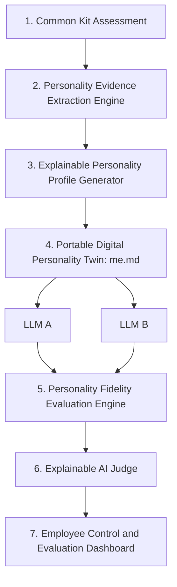

# PersonaTwin AI

## An Evidence-Grounded, Portable and Explainable Digital Personality Twin for Cross-LLM Behavioral Simulation and Evaluation

**CGU Hackathon – Digital Twin Track**  
**Sponsored by Wethos**

---

## Table of Contents

1. [Project Overview](#1-project-overview)
2. [Understanding the Challenge](#2-understanding-the-challenge)
3. [Extracted Functional Requirements](#3-extracted-functional-requirements)
4. [Extracted Non-Functional Requirements](#4-extracted-non-functional-requirements)
5. [Proposed Research Topic](#5-proposed-research-topic)
6. [Research Questions](#6-research-questions)
7. [Proposed System Architecture](#7-proposed-system-architecture)
8. [Mathematical Modeling and Research Methodology](#8-mathematical-modeling-and-research-methodology)
9. [Explainable AI Personality Judge](#9-explainable-ai-personality-judge)
10. [Evaluation and Experimental Design](#10-evaluation-and-experimental-design)
11. [Ethical AI and Privacy Engineering](#11-ethical-ai-and-privacy-engineering)
12. [Proposed Technology Stack](#12-proposed-technology-stack)
13. [Nine-Hour Hackathon Development Strategy](#13-nine-hour-hackathon-development-strategy)
14. [Competition Scoring Strategy](#14-competition-scoring-strategy)
15. [Innovation and Research Contributions](#15-innovation-and-research-contributions)
16. [Final Project Definition](#16-final-project-definition)
17. [Conclusion and Future Work](#17-conclusion-and-future-work)

---

# 1. Project Overview

PersonaTwin AI is a human-centered artificial intelligence system designed to transform structured personality assessment responses into portable, explainable digital personality profiles that can be used across different Large Language Models (LLMs).

The project is developed in response to the CGU Hackathon Digital Twin Track, sponsored by Wethos.

The central objective is to develop an evidence-grounded digital personality representation that captures an individual's expressed preferences, behavioral tendencies, decision-making patterns, priorities, and communication characteristics without making unsupported psychological assumptions or assigning fixed personality labels.

The platform introduces three interconnected capabilities:

1. **Personality Representation:** Transform standardized assessment responses into an evidence-supported, portable personality profile.
2. **Personality-Conditioned Generation:** Enable different LLMs to generate responses using the same personality profile.
3. **Personality Fidelity Evaluation:** Evaluate how closely generated responses reflect the individual's actual expressed tendencies, preferences, and communication patterns.

The system automatically generates a downloadable Markdown personality file named `me.md`. This file must work unchanged across the two designated LLMs.

An Explainable Personality Fidelity Judge subsequently evaluates generated responses against the individual's actual recorded answers, identifying meaningful similarities, inconsistencies, generic responses, and situations where insufficient evidence exists.

## 1.1 Project Vision

To develop a portable, transparent, evidence-grounded, and employee-controlled digital personality representation that enables responsible personality-conditioned AI interactions across different language models.

## 1.2 Core Research and Engineering Disciplines

The project integrates:

- Artificial Intelligence and Large Language Models.
- Data Science and computational personality modeling.
- Natural Language Processing and behavioral simulation.
- Explainable Artificial Intelligence (XAI).
- Semantic similarity and evidence-based evaluation.
- Privacy engineering and responsible AI.
- Human-Computer Interaction.
- Digital identity and workplace communication.

## 1.3 Target Users

| User | Primary Purpose |
|---|---|
| Employees | Create, review, correct, export, and control their digital personality profiles. |
| Team Leads | Support voluntary workplace coaching and communication. |
| Coaching Platforms | Personalize coaching interactions. |
| HR Platforms | Support voluntary employee development and communication initiatives. |
| AI Services | Consume portable personality profiles to generate conditioned responses. |

The employee remains the owner and controller of their personality representation.

---

# 2. Understanding the Challenge

## 2.1 The Fundamental Problem

The challenge describes a situation in which an employee completes a standardized personality assessment, taking approximately 20–30 minutes.

The answers are converted into a portable Markdown file called `me.md`.

That file becomes the employee's digital personality profile, which can subsequently be supplied to different LLMs.

The LLMs use the profile to generate responses to questions or workplace scenarios.

An AI judge then evaluates whether those generated responses resemble the actual person's:

- Expressed preferences.
- Decision-making tendencies.
- Communication patterns.
- Reasoning preferences.
- Priorities.
- Behavioral tendencies in the supplied situations.

The system must distinguish between a genuinely personality-consistent response and an answer that simply sounds intelligent, professional, or convincing.

## 2.2 The Underlying Research Problem

There are three interconnected research and engineering problems.

### Problem 1: Personality Representation

How can assessment answers be transformed into a structured, portable, evidence-supported representation of an individual?

### Problem 2: Personality-Conditioned Generation

How can different LLMs generate responses that reflect the same person's supported tendencies using an identical personality profile?

### Problem 3: Personality Fidelity Evaluation

How can we determine whether generated responses genuinely resemble the individual rather than merely exhibiting fluent or generic language?

The third problem is particularly important because AI judge quality represents 20% of the judging criteria, while personality performance accounts for another 25%.

---

# 3. Extracted Functional Requirements

Functional requirements describe what the application must actually do.

The following requirements are organized into nine functional modules.

## FR-01: Personality Assessment Ingestion

**Priority: Mandatory**

The application must:

- Accept completed Common Kit answers.
- Support the organizer-provided input format.
- Validate required questions and responses.
- Detect missing or malformed answers.
- Preserve the original answers.
- Associate answers with their corresponding question identifiers.
- Allow the individual to review and correct answers.
- Avoid silently changing the person's original responses.

**Expected output:** A validated assessment dataset.

## FR-02: Personality Profile Generation

**Priority: Mandatory**

The application must convert assessment answers into a downloadable `me.md` file.

The profile must:

- Describe broad personality tendencies.
- Identify expressed preferences and priorities.
- Describe communication patterns.
- Capture situational behavioral tendencies.
- Avoid unsupported personality conclusions.
- Avoid presenting tendencies as permanent characteristics.
- Distinguish observed evidence from interpretations.
- Link important claims to their supporting answers.
- Include uncertainty when the evidence is insufficient.

**Expected output:** A readable, portable Markdown personality profile.

## FR-03: Evidence Traceability

**Priority: Mandatory**

Every important personality claim must be traceable to its source.

For example:

| Personality Claim | Supporting Evidence |
|---|---|
| Prefers collaborative problem-solving | Answers A03, A07 |
| Values structured communication | Answers A04, A09 |
| Tends to consider alternative solutions | Answers A05, A11 |

These are illustrative examples, not assumptions about an actual participant.

The application must also identify claims that lack sufficient supporting evidence.

## FR-04: Portable LLM Interoperability

**Priority: Mandatory**

The generated `me.md` must:

- Work unchanged on both designated LLMs.
- Require no model-specific rewriting.
- Provide clear instructions to the receiving LLM.
- Preserve the meaning of the personality profile.
- Avoid dependencies on a proprietary personality database.
- Be reusable across different AI services.

An important technical requirement is that the same file must be tested on both models, not two independently optimized versions.

## FR-05: Personality-Conditioned Response Generation

**Priority: Mandatory for demonstration**

The system must:

- Load the generated personality profile.
- Present questions or workplace scenarios to the LLM.
- Generate responses conditioned on the profile.
- Run the same scenarios on both designated models.
- Preserve the original scenario and prompt.
- Store generated responses for evaluation.

Generated responses must never be presented as the employee's actual statements, approvals, or commitments.

## FR-06: AI Personality Judge

**Priority: Mandatory**

The AI judge must evaluate generated responses against the actual volunteer's recorded answers.

It must:

- Compare generated responses with reference answers.
- Identify meaningful personality similarities.
- Identify personality inconsistencies.
- Evaluate communication-style resemblance.
- Evaluate preference and reasoning-pattern resemblance.
- Distinguish genuine resemblance from generic fluency.
- Identify insufficient evidence.
- Explain every important evaluation.
- Provide supporting evidence.
- Avoid treating the Wethos twin as the ground-truth answer.

## FR-07: Comparative Evaluation

**Priority: Mandatory**

The application must support the following evaluation structure:

| Evaluation Category | Number of Responses |
|---|---:|
| Your model – LLM 1 with profile | 4 |
| Your model – LLM 2 with profile | 4 |
| LLM 1 without profile | 4 |
| LLM 2 without profile | 4 |
| Wethos personality twin | 4 |
| **Total** | **20** |

The judge evaluates all 20 generated responses.

The volunteer's four recorded answers are reference evidence, not outputs to score.

The system should preserve:

- Model identity.
- Scenario identifier.
- Original prompt.
- Generated response.
- Profile version.
- Evaluation results.

## FR-08: Employee Control and Consent

**Priority: Mandatory**

The employee must be able to:

- Understand what information is collected.
- Understand how the information is processed.
- Review the generated personality profile.
- Challenge unsupported claims.
- Correct original assessment answers.
- Regenerate the profile after corrections.
- Decide whether to export the profile.
- Decide whether and with whom to share it.
- Withdraw consent for future processing and sharing.

The application must explicitly distinguish voluntary consent from employer requests.

## FR-09: Optional Alternative Intake

**Priority: Extra credit – up to 10 points**

The application may provide an additional personality-information collection method.

Possible approaches include:

- Guided conversational interview.
- Free-response questions.
- Scenario-based interview.
- Another appropriately licensed assessment.

The alternative intake must be demonstrated with a consenting teammate and compared against the Common Kit approach, including profile quality, time, effort, and limitations.

The additional intake cannot replace the mandatory Common Kit workflow.

---

# 4. Extracted Non-Functional Requirements

Non-functional requirements describe how reliably, securely, ethically, and effectively the application must operate.

The following are proposed engineering requirements. Numerical targets are design goals, not official organizer specifications.

## 4.1 Core Non-Functional Requirements

| ID | Requirement | Proposed Implementation |
|---|---|---|
| NFR-01 | Portability | Standard Markdown, UTF-8, no proprietary dependencies. |
| NFR-02 | Interoperability | Identical `me.md` on both designated LLMs. |
| NFR-03 | Explainability | Claims linked to supporting assessment answers. |
| NFR-04 | Reliability | Input validation and reproducible processing. |
| NFR-05 | Privacy | Minimize collection and avoid unnecessary storage. |
| NFR-06 | Security | Encryption, access controls, secure API credential handling. |
| NFR-07 | User Control | Review, correction, export, and sharing controls. |
| NFR-08 | Consent | Explicit informed consent before AI processing and sharing. |
| NFR-09 | Fairness | Do not equate polished English with personality similarity. |
| NFR-10 | Uncertainty | Allow insufficient evidence as a valid evaluation. |
| NFR-11 | Performance | Target profile generation under 15 seconds, excluding external API delays. |
| NFR-12 | Usability | Simple assessment upload and profile review workflow. |
| NFR-13 | Maintainability | Modular architecture and documented interfaces. |
| NFR-14 | Reproducibility | Preserve prompts, model versions, parameters, and evaluation records. |
| NFR-15 | Auditability | Maintain traceable records of profile generation and evaluation. |
| NFR-16 | Ethical Robustness | Prevent use for employee ranking, hiring, or disciplinary decisions. |

## 4.2 Additional Critical Non-Functional Requirements

### NFR-17: Evidence Sufficiency

The system must not infer a personality characteristic from a single weak or ambiguous answer without explicitly qualifying the claim.

### NFR-18: Semantic Consistency

The same personality profile should communicate equivalent information to different LLMs, even if their generated language differs.

### NFR-19: Non-Determinism Awareness

Repeated LLM generations may differ. The system should not interpret one generated response as a definitive representation of the person.

### NFR-20: Profile Versioning

When an individual corrects answers, the application should generate a new profile version and preserve the distinction between the previous and corrected versions.

### NFR-21: Separation of Identity and Personality Data

The system should avoid including unnecessary identifiers, employer information, or personally identifying details in the portable personality file.

---

# 5. Proposed Research Topic

## Recommended Project Topic

# PersonaTwin AI

### An Evidence-Grounded, Portable and Explainable Digital Personality Twin for Cross-LLM Behavioral Simulation and Evaluation

**Research positioning:**

A human-centered AI framework for modeling expressed personality tendencies, generating personality-conditioned responses, and measuring behavioral fidelity across large language models.

## 5.1 Research Proposition

Develop a system that transforms an individual's assessment responses into a portable, evidence-grounded personality representation, enables different LLMs to simulate responses using that representation, and evaluates the fidelity of those responses against the individual's actual expressed preferences and communication patterns.

## 5.2 Why This Topic?

The proposed topic addresses all three core requirements of the challenge:

**Representation:** How accurately can we extract and represent personality tendencies from structured assessment answers?

**Simulation:** Can different LLMs use the same portable personality profile to generate consistent, personality-conditioned responses?

**Evaluation:** Can an explainable AI judge distinguish authentic personality resemblance from generic language generation?

The research contribution is not merely another personality chatbot.

It is a framework for evaluating the reliability of portable digital personality representations across different AI models.

---

# 6. Research Questions

## 6.1 Primary Research Question

To what extent can an evidence-grounded, portable digital personality representation improve cross-LLM behavioral and communication-style fidelity, and how reliably can an explainable AI judge identify meaningful personality similarities, inconsistencies, and insufficient evidence?

## 6.2 Supporting Research Questions

- **RQ1:** How accurately can structured assessment answers be transformed into evidence-supported personality representations?
- **RQ2:** Does providing a standardized personality profile improve the resemblance of LLM-generated responses to an individual's expressed tendencies?
- **RQ3:** How consistent are personality-conditioned responses across two different LLMs?
- **RQ4:** Can an AI judge distinguish personality fidelity from generic fluency and stylistic sophistication?
- **RQ5:** How do profile uncertainty, evidence coverage, and source-answer quality influence evaluation reliability?
- **RQ6:** How can individual consent, explainability, and control be incorporated into portable digital personality systems?

These questions provide a foundation for future research beyond the hackathon.

---

# 7. Proposed System Architecture

PersonaTwin AI uses a modular architecture with seven primary components.

## 7.1 Architecture Overview



## 7.2 Component Descriptions

| Component | Main Responsibility |
|---|---|
| Assessment Ingestion | Parse and validate Common Kit answers. |
| Evidence Extraction | Identify supported personality tendencies. |
| Profile Generator | Produce the portable `me.md`. |
| LLM Orchestration | Execute identical tests on both models. |
| Fidelity Evaluator | Measure behavioral and communication resemblance. |
| AI Judge | Explain matches, mismatches, and uncertainty. |
| User Control Dashboard | Review, correction, consent, and sharing. |

## 7.3 Architectural Design Principle

A key architectural decision is to keep the personality profile generation engine separate from the AI judge.

Otherwise, the judge could simply reinforce the assumptions made by the profile generator.

The judge must independently retrieve and assess the original reference evidence.

---

# 8. Mathematical Modeling and Research Methodology

This section introduces the proposed Data Science contribution.

The system uses a multidimensional personality representation with evidence traceability and uncertainty estimation.

Importantly, this is not presented as a clinically validated personality assessment. It is a computational representation of tendencies expressed in the supplied answers.

## 8.1 Personality Representation

Let an individual be represented by:

\[
P_u = \{T_u,V_u,C_u,E_u,U_u\}
\]

Where:

- \(T_u\): Supported personality tendencies.
- \(V_u\): Expressed preferences and priorities.
- \(C_u\): Communication patterns.
- \(E_u\): Evidence supporting each claim.
- \(U_u\): Uncertainty associated with each claim.

For example:

| Dimension | Example of an Observable Tendency |
|---|---|
| Collaboration | Expressed preference for collaborative problem-solving. |
| Decision-making | Tends to compare alternatives before deciding. |
| Communication | Prefers structured explanations. |
| Conflict Response | Expresses a preference for constructive discussion. |
| Planning | Values advance preparation. |
| Adaptability | Expresses willingness to reconsider an approach. |

These dimensions should only be used where the Common Kit provides supporting evidence.

## 8.2 Evidence-Support Model

Let:

- \(a_i\) represent assessment answer \(i\).
- \(t_j\) represent personality tendency \(j\).
- \(w_{ij}\) represent the relevance of answer \(i\) to tendency \(j\).
- \(e_{ij}\) represent the strength of evidence.

Define:

\[
S(t_j)=
\frac{\sum_{i=1}^{n}w_{ij}e_{ij}}
{\sum_{i=1}^{n}w_{ij}}
\]

Where the denominator is positive.

The result estimates how strongly the supplied answers support a particular tendency.

This is a proposed evidence aggregation mechanism, not an established psychological measurement.

The individual supporting answers should also be retained rather than relying exclusively on the aggregate score.

## 8.3 Evidence Coverage

A profile should not make a claim simply because an LLM can generate one.

Define:

\[
C_j =
\frac{\text{Number of relevant answers supporting }t_j}
{\text{Number of relevant answers available for }t_j}
\]

This measures evidence coverage, not personality strength.

For example, if a characteristic is addressed by four relevant questions but only one contains usable evidence, its coverage is limited.

The profile generator should qualify the claim or state that evidence is insufficient.

## 8.4 Cross-LLM Behavioral Simulation

Let:

\[
R_{m,q}=LLM_m(P_u,Q_q)
\]

Where:

- \(P_u\): The person's portable personality profile.
- \(Q_q\): A test scenario.
- \(LLM_m\): One of the designated models.
- \(R_{m,q}\): The generated response.

The same profile and scenario should be supplied to both models.

The system should record:

- Exact prompt.
- Model version.
- Generation parameters.
- Original profile version.
- Generated output.

## 8.5 Personality Fidelity Evaluation

Personality fidelity is separated into four dimensions.

| Dimension | What It Measures |
|---|---|
| Preference Fidelity | Whether the response reflects expressed preferences. |
| Reasoning Fidelity | Whether the response reflects supported reasoning tendencies. |
| Communication Fidelity | Whether the communication pattern resembles the reference. |
| Situational Fidelity | Whether the response reflects supported tendencies in the scenario. |

A proposed composite score is:

\[
F=0.30P+0.25R+0.25C+0.20S
\]

Where:

- \(P\): Preference fidelity.
- \(R\): Reasoning fidelity.
- \(C\): Communication fidelity.
- \(S\): Situational fidelity.

These weights are initial experimental choices, not validated psychological weights.

The system should report the component scores alongside the composite score.

### Important Evaluation Principle

The judge must not reward a model simply because it:

- Uses sophisticated vocabulary.
- Writes longer answers.
- Uses formal corporate language.
- Sounds confident.
- Produces grammatically polished English.

A concise response may be more personality-consistent than a polished but generic response.

## 8.6 Uncertainty-Aware Evaluation

An explicit insufficient-evidence mechanism is essential.

Define:

\[
J(R,P_u)=
\begin{cases}
\text{Evaluate}, & E(R,P_u)\geq\tau\\
\text{Insufficient Evidence}, & E(R,P_u)<\tau
\end{cases}
\]

Where:

- \(E\): Available relevant evidence.
- \(\tau\): Predefined evidence sufficiency threshold.

The threshold should be calibrated experimentally.

This prevents the AI judge from manufacturing conclusions when the reference answers do not support them.

---

# 9. Explainable AI Personality Judge

The AI judge is one of the central technical innovations of PersonaTwin AI.

Rather than asking an LLM whether an answer sounds like someone, the system uses a structured evaluation pipeline.

## 9.1 Evaluation Pipeline

1. **Response Ingestion:** Load the generated response, scenario, model identity, and reference evidence.
2. **Evidence Retrieval:** Retrieve only the relevant Common Kit answers and profile claims.
3. **Multidimensional Comparison:** Compare preferences, reasoning, communication, and situational tendencies.
4. **Generic Fluency Detection:** Identify polished but generic answers that lack meaningful personal resemblance.
5. **Contradiction Analysis:** Identify inconsistencies between the generated response and supported tendencies.
6. **Evidence Sufficiency Check:** Determine whether enough evidence exists to make an assessment.
7. **Explainable Output:** Generate scores, evidence references, explanations, and uncertainty.

## 9.2 Proposed Judge Output

Each evaluation should return a structured result such as:

```json
{
  "scenario_id": "Q01",
  "model": "LLM_A",
  "preference_fidelity": 0.85,
  "reasoning_fidelity": 0.78,
  "communication_fidelity": 0.82,
  "situational_fidelity": 0.75,
  "overall_fidelity": 0.80,
  "evidence_sufficiency": "sufficient",
  "matches": [
    {
      "claim": "Preference for structured communication",
      "evidence": ["A04", "A09"],
      "explanation": "The response uses an organized approach consistent with the supplied answers."
    }
  ],
  "mismatches": [],
  "limitations": [
    "The response does not establish how the individual would behave outside this scenario."
  ]
}
```

The numerical values are illustrative, not measured results.

## 9.3 Three Distinct Evaluation Concepts

The output should distinguish:

1. Personality consistency.
2. Linguistic similarity.
3. Semantic similarity.

These are not interchangeable.

Two answers can use entirely different words but express the same underlying preference.

---

# 10. Evaluation and Experimental Design

The hackathon has a predefined evaluation procedure. The implementation must follow that procedure.

## 10.1 Required Evaluation Matrix

**Total: 20 Model Outputs**

| Group | Model | Responses |
|---|---|---:|
| A | Your LLM 1 + Profile | 4 |
| B | Your LLM 2 + Profile | 4 |
| C | LLM 1 Without Profile | 4 |
| D | LLM 2 Without Profile | 4 |
| E | Wethos Twin | 4 |
| **Total** | | **20** |

The organizer-provided Wethos responses must be evaluated by the judge.

The actual volunteer's four recorded answers serve as reference evidence.

The volunteer's answers are never scored.

## 10.2 Experimental Comparisons

### Experiment 1: Profile Effectiveness

Compare profile-conditioned LLM outputs against no-profile outputs.

**Research question:** Does the personality profile improve resemblance to the volunteer?

### Experiment 2: Cross-Model Consistency

Compare LLM 1 and LLM 2 using the identical `me.md`.

**Research question:** Does the portable profile preserve its meaning across different model architectures?

### Experiment 3: Judge Reliability

Compare the AI judge's explanations with anonymous human evaluations.

**Research question:** Does the judge identify meaningful personality resemblance rather than rewarding generic fluency?

## 10.3 Human Evaluation

The volunteer's anonymous writing ratings are particularly valuable.

The AI judge should not be treated as ground truth.

We can compare the AI judge's evaluations against human ratings using:

- Spearman rank correlation.
- Mean Absolute Error, if comparable numerical ratings are available.
- Agreement analysis.
- Qualitative disagreement analysis.

Given the small number of hackathon samples, these results should be described as preliminary rather than statistically conclusive.

## 10.4 Proposed Evaluation Metrics

| Metric | Purpose |
|---|---|
| Evidence Precision | How many generated profile claims have adequate support? |
| Evidence Coverage | How much relevant assessment evidence is represented? |
| Unsupported Claim Rate | How often does the profile invent characteristics? |
| Personality Fidelity | How closely do outputs reflect supported tendencies? |
| Cross-Model Consistency | How consistently do models interpret the same profile? |
| Judge-Human Agreement | How closely do judge assessments align with human ratings? |
| Uncertainty Calibration | Does the judge abstain when evidence is inadequate? |
| Generic Fluency Discrimination | Can the judge avoid confusing polished writing with resemblance? |

---

# 11. Ethical AI and Privacy Engineering

Ethical design must be a first-class system requirement, not a paragraph added to the presentation.

## 11.1 Ethical Safeguards

| Risk | Proposed Safeguard |
|---|---|
| Employer Coercion | Explicit employee-controlled consent. |
| Unsupported Personality Claims | Answer-level evidence traceability. |
| Personality Stereotyping | Describe tendencies, not fixed identities. |
| Language Bias | Separate writing sophistication from personality fidelity. |
| Over-Trust | Display uncertainty and limitations. |
| Profile Misuse | Prohibit employment ranking and disciplinary use. |
| Data Exposure | Minimize storage and protect personal materials. |
| Incorrect Profile | Employee review and correction before export. |
| Unauthorized Sharing | Explicit sharing authorization and access control. |
| Model Misrepresentation | Label every generated response as simulated AI output. |

## 11.2 Data Minimization

The profile should not contain more information than is needed for its intended purpose.

The employee should be able to export a profile without exposing raw assessment answers to the receiving organization.

## 11.3 Consent and Control

The system must:

- Obtain informed consent before collecting and processing personal information.
- Explain which AI services receive information.
- Explain who can access the profile.
- Provide profile review and correction.
- Allow voluntary export and sharing.
- Support withdrawal of consent for future processing.
- Keep real evaluation materials out of public repositories.

---

# 12. Proposed Technology Stack

For a nine-hour hackathon, a lightweight and modular technology stack is recommended.

| Layer | Recommended Technology | Purpose |
|---|---|---|
| Frontend | React + TypeScript | User interface. |
| Backend | Python + FastAPI | Application and API. |
| Data Validation | Pydantic | Assessment and evaluation schemas. |
| Profile Generation | Python + LLM API | Evidence-grounded `me.md`. |
| LLM Integration | Designated LLM APIs | Cross-model simulation. |
| AI Judge | Python + LLM + deterministic checks | Explainable evaluation. |
| NLP | Sentence Transformers or Embeddings API | Semantic comparison. |
| Data Processing | Pandas | Structured assessment analysis. |
| Storage | SQLite or temporary in-memory storage | Prototype data. |
| Export | Python Markdown generation | Downloadable personality profile. |
| Testing | Pytest | Functional and integration testing. |
| Deployment | Local application or lightweight cloud deployment | Demonstration. |

The implementation should avoid unnecessary microservices and infrastructure complexity.

The priority is a complete, reliable, demonstrable pipeline.

---

# 13. Nine-Hour Hackathon Development Strategy

The challenge provides nine hours, from 9:00 AM to 6:00 PM.

Mandatory requirements must be prioritized before optional extra credit.

## 13.1 Development Roadmap

| Time | Development Phase | Main Tasks |
|---|---|---|
| 9:00–9:45 AM | Requirements and Common Kit Analysis | Inspect Sections 7, 8, 11, 12, and 13; define schemas; establish consent procedures. |
| 9:45–11:00 AM | Assessment and Profile Converter | Implement ingestion, evidence extraction, `me.md` generation, and export. |
| 11:00 AM–12:00 PM | Profile Review and Correction | Implement profile preview, evidence references, correction, and regeneration. |
| 12:00–1:15 PM | Cross-LLM Integration | Integrate both designated models and generate eight required responses. |
| 1:15–2:45 PM | AI Judge | Implement evidence retrieval, fidelity evaluation, generic fluency detection, and insufficient-evidence handling. |
| 2:45–3:45 PM | Evaluation Dashboard | Display comparisons, explanations, and Wethos responses. |
| 3:45–4:30 PM | Testing and Code Freeze | Test the complete workflow, verify portability, and freeze the code. |
| 4:30–5:30 PM | Volunteer Evaluation | Process the new volunteer's answers and evaluate all 20 required outputs. |
| 5:30–6:00 PM | Submission Preparation | Verify deliverables, documentation, and presentation materials. |
| 6:30 PM | Final Presentation | Five-minute presentation followed by three minutes of questions. |

## 13.2 Critical Deadline

The most important deadline is **4:30 PM**.

The judge must be frozen before the new volunteer's evaluation materials arrive.

Therefore, the complete evaluation pipeline must be tested thoroughly before the code freeze.

---

# 14. Competition Scoring Strategy

The competition evaluates five primary criteria.

| Criterion | Weight | Development Priority |
|---|---:|---|
| Personality Performance | 25% | Evidence-grounded response generation and meaningful resemblance. |
| Converter and Portability | 20% | Reliable `me.md` generation and identical cross-LLM testing. |
| AI Judge Quality | 20% | Explainable evaluation, evidence retrieval, and uncertainty handling. |
| Ethical AI | 20% | Consent, privacy, profile correction, and employee control. |
| Transdisciplinary Research | 15% | Integration of computational modeling, behavioral research, NLP, and workplace practice. |
| **Base Total** | **100%** | |

**Optional Intake Extension:** Up to 10 bonus points.

The optional intake extension should not consume time needed to implement the mandatory converter, both LLM integrations, and AI judge.

A guided conversational interview could be explored as a separate experiment, provided the Common Kit workflow remains complete.

---

# 15. Innovation and Research Contributions

PersonaTwin AI offers five opportunities for differentiation.

| Innovation | Description | Research Value |
|---|---|---|
| Evidence-Grounded Personality Modeling | Every important claim references source answers. | Trustworthiness and explainability. |
| Cross-LLM Portability Testing | Identical profile tested on different models. | Interoperability and consistency. |
| Uncertainty-Aware Personality Judge | Explicitly identifies insufficient evidence. | Responsible AI evaluation. |
| Fluency-versus-Fidelity Discrimination | Separates writing quality from personality resemblance. | Evaluation reliability. |
| Employee-Controlled Digital Identity | User reviews, corrects, exports, and authorizes sharing. | Ethical innovation. |

## 15.1 Central Innovation

The most interesting differentiator is the distinction between fluency and personality fidelity.

Most AI evaluation systems focus on whether an answer is relevant, coherent, or semantically similar.

PersonaTwin AI investigates a more specific question:

**Does this answer reflect the person's supported tendencies, or does it merely sound like a good answer?**

That is a meaningful research and engineering contribution.

---

# 16. Final Project Definition

## 16.1 Official Project Title

**PersonaTwin AI: An Evidence-Grounded, Portable and Explainable Digital Personality Twin for Cross-LLM Behavioral Simulation and Evaluation**

## 16.2 Project Overview

PersonaTwin AI is a human-centered artificial intelligence system designed to transform structured personality assessment responses into portable, explainable digital personality profiles that can be used across different large language models.

The platform introduces an evidence-grounded personality representation that captures an individual's expressed preferences, behavioral tendencies, decision-making patterns, and communication characteristics without making unsupported psychological assumptions or assigning fixed personality labels.

Using a standardized assessment-to-profile conversion pipeline, the system automatically generates a downloadable Markdown personality file (`me.md`). This file is designed to operate unchanged across two designated LLMs, enabling cross-model behavioral simulation and interoperability.

The platform also introduces an Explainable Personality Fidelity Judge, an AI evaluation framework that compares generated model responses against the individual's actual recorded answers.

It identifies:

- Meaningful personality similarities.
- Behavioral and preference inconsistencies.
- Communication-pattern differences.
- Generic responses.
- Situations where available evidence is insufficient to support an evaluation.

## 16.3 Primary Research Objective

To develop and experimentally evaluate an evidence-grounded, portable digital personality representation and an explainable AI framework for measuring personality-conditioned response fidelity across different large language models.

## 16.4 Core Technical Contributions

1. A Common Kit assessment ingestion and validation pipeline.
2. An evidence-grounded personality extraction and representation engine.
3. An explainable, downloadable, cross-LLM-compatible `me.md` generator.
4. A dual-LLM personality-conditioned response generation framework.
5. An uncertainty-aware personality fidelity evaluation engine.
6. An explainable AI judge with evidence-linked assessments.
7. An employee-controlled profile review, correction, export, and sharing interface.

## 16.5 Intended Application

The system is intended to support voluntary workplace coaching, self-reflection, and communication assistance.

It is not designed for:

- Employee ranking.
- Hiring decisions.
- Promotion decisions.
- Disciplinary decisions.
- Automated judgments about an individual's professional suitability.

Simulated responses must never be represented as the employee's actual statements, approvals, or commitments.

---

# 17. Conclusion and Future Work

PersonaTwin AI addresses an important challenge in human-centered artificial intelligence: how to represent an individual's expressed personality tendencies in a portable, explainable, and responsible manner while evaluating whether different AI systems can faithfully use that representation.

The project combines computational personality representation, large language models, natural language processing, explainable AI, uncertainty estimation, and privacy engineering into a single integrated framework.

Its principal research contribution is the investigation of cross-model personality fidelity and the development of an evidence-based mechanism for distinguishing genuine personality resemblance from generic language generation.

Three factors make this project particularly valuable:

1. **Technical Depth:** NLP, LLM orchestration, evidence extraction, semantic evaluation, uncertainty estimation, and explainable AI.
2. **Research Contribution:** Cross-model personality fidelity rather than simply generating personality descriptions.
3. **Ethical Significance:** Portability, informed consent, individual control, explainability, and protection against misuse.

### Important Implementation Qualification

The organizers' Common Kit Sections 7, 8, 11, 12, and 13 are essential.

Those sections must be obtained and examined before finalizing the input schemas, profile-generation specifications, evaluation output, scoring algorithms, and submission deliverables.

The specifications in this proposal are a preliminary engineering and research design. The official Common Kit requirements take precedence wherever differences exist.

### Recommended Next Development Phase

Translate this proposal into a complete technical implementation blueprint covering:

- Database schemas.
- API endpoints.
- Python backend modules.
- React frontend components.
- LLM orchestration.
- Personality evidence extraction.
- Mathematical evaluation algorithms.
- AI judge implementation.
- Privacy and consent mechanisms.
- Functional and integration tests.
- Deployment and demonstration procedures.

Every implementation component should be mapped to the official competition requirements and judging criteria.

---

**Project:** PersonaTwin AI  
**Track:** CGU Hackathon – Digital Twin Track  
**Sponsor:** Wethos  
**Research Area:** Explainable AI, Computational Personality Modeling, and Cross-LLM Behavioral Fidelity  
**Primary Deliverable:** Portable `me.md` personality profile and Explainable AI Personality Judge

